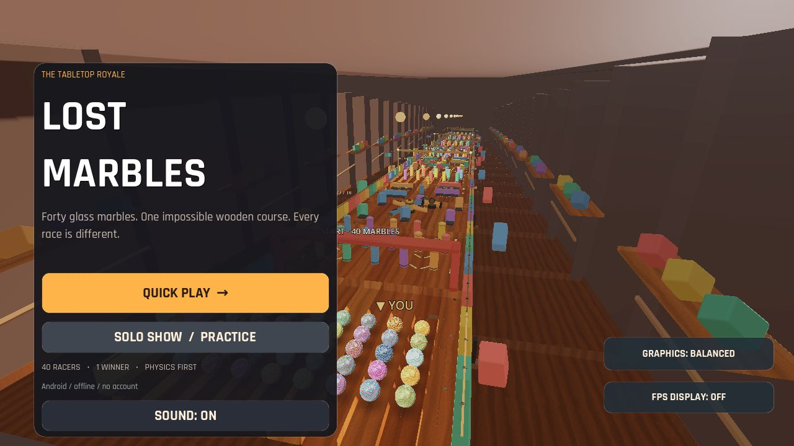
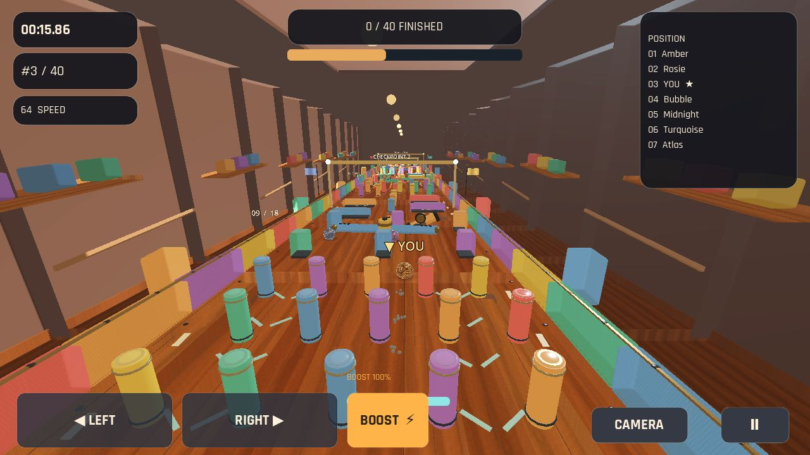
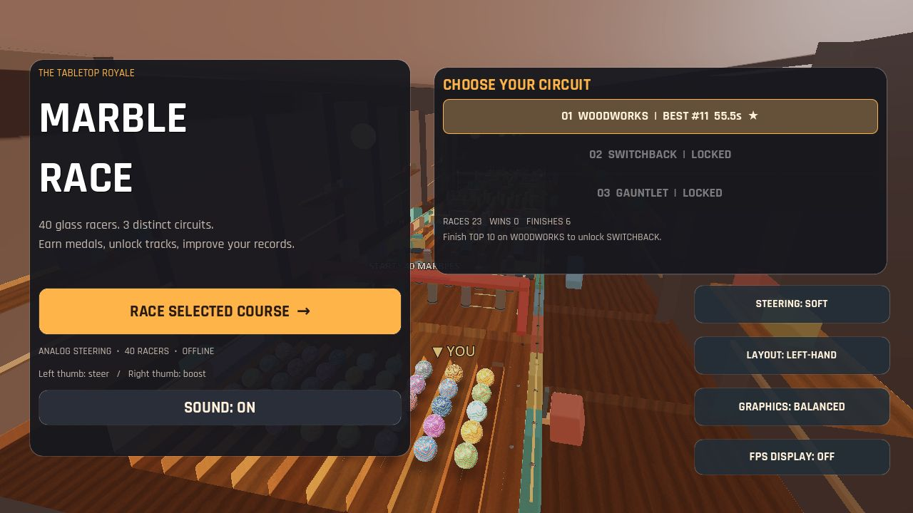
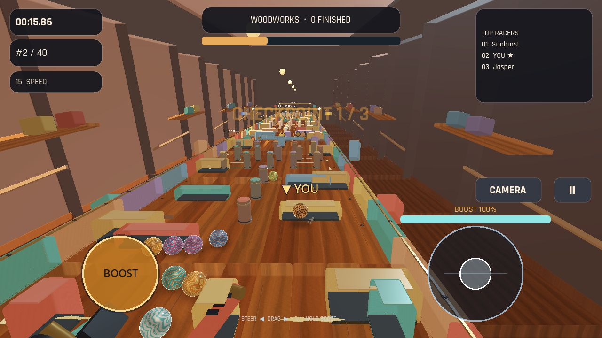

# Marble Race: Lost Tracks

Original **3D Android marble-racing game** inspired by the look and mechanics shown in Meticulai Games' [Lost Marbles](https://x.com/MeticulAi/status/2111568537684955500) reference video.

Independent implementation in **Godot 4.5.1**, focused on real mobile playability, physics, and stylized toy-table graphics. No proprietary material from the reference game is redistributed.

## Current state: Android QA build (v0.6)

- 40 independently simulated rigid-body glass marbles with seeded visual variations and position-aware AI
- 18 segments of inclined wooden planks, rounded colorful safety rails, toy blocks, posts, slalom, rotating paddles, *new swinging hammers*, start/finish arches, checkpoint gates
- Procedural PBR-ish oak color + normal maps; glossy 3D glass shader and soft rim highlights; rounded wooden and plastic geometry
- Warm miniature-workshop environment: walnut workbench, shelves, colored toys, suspended lights, distance fog
- Six perks: Lead Core, Grip Tape, Bounce Back, Aerodynamic, Sticky Magnet and Head Start
- Physically driven recovery impulse for marbles wedged against obstacles — no teleporting or forced scripted paths
- Celebration bursts and audio checkpoints as the player crosses three progress arches
- Responsive orbit-style third-person camera with velocity-dependent field of view and impact camera shake; touch steering, rechargeable boost, three views
- Animated player spark trail, responsive 2D menu and racing HUD with Rajdhani UI fonts
- **v0.4:** physically rolling boost halo, layered swirling-glass optics, instanced brass track rivets, animated checkpoint lanterns and painted chevrons. Adaptive wind and a dynamic percussion stem respond to marble velocity; original finish fanfare and mute preference stored locally.
- **Audio**: quiet original synthesized looping soundtrack, original countdown/start/finish/boost tones, speed-following wooden rolling loop, CC0 wood/glass impacts and UI click samples with a channel pool; in-game mute toggle
- All gameplay content works without internet access; no tracking, no ads and no account.

## Play

Requires [Godot 4.5.1](https://godotengine.org/download/).

```bash
godot --headless --editor --path . --quit
godot --path .
```

On Android: landscape orientation → **QUICK PLAY** → select perk → **START RACE**. Hold LEFT/RIGHT to steer, hold BOOST to accelerate, select CAMERA to switch angle. On PC: **A/D** or arrow keys, **Space**, **C**. Sound may be disabled in the main menu.

## Get a debug Android APK

**GitHub Actions → "Verify and build Android APK" → latest successful run → Artifacts → marble-race-android-debug.** The workflow downloads matching Godot 4.5.1 export templates, tests gameplay, builds an ARM64 debug APK, verifies signature and publishes the artifact for 21 days.

To build locally with Godot: install matching export templates, Android SDK platform 35 + build-tools 35, JDK 17; configure **Editor Settings → Export → Android** for JDK/SDK; run:

```bash
godot --headless --editor --path . --quit
godot --headless --path . --export-debug Android build/marble-race-debug.apk
```

This produces a **debug-signed** APK for direct installation. For Play Store release, create a private release keystore, sign an **AAB**, validate the Android policy and capture real-device performance; do not commit signing keys or secrets.

## Verification

```bash
godot --headless --path . --script res://tests/smoke.gd
godot --headless --fixed-fps 60 --path . --script res://tests/race_diagnostic.gd
```

The smoke test asserts scene, track, 40 physical racers, six-perk-compatible state, player selection, countdown, motion, boost and camera; the long-running diagnostic simulates 110 seconds of game physics and verifies actual racer progress and finishers. Both passed in the build environment. A GL Compatibility rendering pass at 1280×720 was also captured under Mesa; an Android device GPU performance benchmark is still required.

## Assets and reproducibility

- Original procedural textures/music/icon are generated by `tools/generate_assets.py` and `tools/generate_icon.py` and `tools/generate_race_audio.py`.
- Regenerate with `pip install numpy Pillow imageio-ffmpeg` and run both scripts.
- CC0 impact and UI samples from **Kenney**, and **Rajdhani** fonts under SIL OFL. See [asset sources and licenses](assets/licenses/ASSET-SOURCES.md).
- No proprietary graphics, sounds or character designs from the reference video were imported.

## Architecture

`scripts/game.gd` owns the modular environment and race state; `scripts/marble.gd` owns physics and AI; `scripts/audio.gd` owns soundtrack and pooled Foley; `scripts/hud.gd` handles touch UI; `scripts/visuals.gd` generates reusable rounded geometry. Shader materials reside in `shaders/` and assets in `assets/`.

**Roadmap:** real Android handset profiling, collision tuning with real touch, audio mix QA, richer workshop props/track variations, saveable settings and release signing.

## v0.4 render pass

Refined procedural oak grain normal-map response and better warm key/ambient balance; additional metallic specular response for brass hardware. Preserves the mobile GL Compatibility renderer and existing physics.


## v0.5 — visibility, surfaces and tactile sound

- Lightweight **batched soft contact shadows** under every physical marble. A single MultiMesh uses a small transparent radial shader rather than 40 dynamic shadow-casting lights.
- **Lacquered barrier shader** with molded-plastic sheen, edge highlights and tiny pigment flecks; reused by race obstacles and spinning paddles.
- **Distance-culling workshop lights** (updates 4 times/second), reducing active local lights in long courses.
- New **positional collision Foley** with seven pooled AudioStreamPlayer3D voices; rolling audio continues to track the player's marble, with a small impact-based music duck.
- Original generated mechanical gear loop that follows the nearest moving paddle/hammer. Rebuild with `python tools/generate_race_audio.py` (requires the packages listed above).
- Player's **YOU marker stays upright** instead of spinning with the physical ball. Added minimalist live progress and boost-charge bars.
- Automated smoke coverage for spatial sounds, shadow pooling, HUD widgets and release of visuals when leaving a race.

All new art and sound assets are independently generated. The engine remains the Godot 4.5.1 GL Compatibility renderer; Android arm64 performance still needs a physical-phone check.


## v0.6 — kinetic obstacle art and physical audio

- Rounded spinner arms with embedded hazard markings and 3D metallic endcaps, center bearings, black steel drive shaft and static base supports; visual meshes follow existing `AnimatableBody3D` collision axes.
- Pendulum hammer assemblies with steel floor mounts, brass joints, visible connecting rods and dark end bumpers; only the visual art changes, so collisions and race logic remain compatible with v0.5.
- Kinetic swinging motion is sampled from **physics simulation time**, rather than frame-render timestamps, for reproducible motion and contacts at 60 fixed physics ticks.
- Progress checkpoint beacons now brighten and pulse when the player crosses them; player marble's sphere mesh is slightly more detailed in close-ups.
- Two original generated metallic impact sounds are spatialized when the player's marble contacts a spinning paddle or swinging hammer (wood and glass impacts remain unchanged).
- `tools/generate_metal_impacts.py` reproducibly generates the new OGG sounds using NumPy and FFmpeg; no commercial audio dependencies.
- Smoke test now asserts all five spinners, five pendulums, hinge meshes, checkpoint flashes, impact sound resources and time-based kinetic animations. Android APK exported for ARM64.
- Rendered image of a real gameplay frame: [v0.6 GL Compatibility preview](docs/screenshots/v0.6-race.jpg). This preview is a software Mesa rendering, not a phone FPS benchmark.


## v0.7 — cinematic tabletop art pass

- Refined glass with two inexpensive studio-softbox reflections directly in the mobile-compatible shader.
- An entirely decorative **new scene layer** adds instanced brass rail top edges, walnut cross bracing, fastener/section markers, checkpoint flagpoles and actively waving silk flags.
- Course dressing has no collision shapes, so race physics and AI remain unchanged; geometry shares shader/material resources and is primarily positioned off the rolling surface.
- The existing 40-racer simulation, mobile GLES Compatibility renderer, six perks, obstacle art, positional audio and dynamic sound stems are retained.

Before release, run the full headless race simulation, capture the graphical regression screenshot and generate a signed Android debug APK. Physical handset benchmarking remains separate from CI validation.


## v0.8 — Toy track polish and Android profiling

- **New obstacle construction details:** chromed protective rings, molded bumper feet, colored peg inlays, contrasted slalom and gate plate finishes. The original colliders are unchanged; the finish uses only **four MultiMesh batches**.
- **Audio:** two synthesized original soft and hard rubber collision recordings, played positionally for pegs; generated reproducibly with `tools/generate_bump_sounds.py`.
- **Mobile render settings:** switch among **ECONOMY / BALANCED / ULTRA** in the title screen. Economy disables expensive lighting effects and decorative batches; Ultra extends local light visibility. The gameplay physics are identical in every mode.
- **FPS display:** optional live counter in the race HUD to profile a real Android handset; switch from the menu. Video settings are saved offline in `user://marble_settings.cfg` and **do not overwrite** the user's saved sound setting.
- Import, physics and Android export smoke checks cover the additional sound and visual assets. The graphics presets trade visual quality against battery/heat; actual device FPS remains to be measured.


### v0.8 OpenGL captures

These captures were generated from the actual Godot Compatibility renderer, not AI concept art.





## v0.9 — Rebuilt Android touch controls

- Left **floating analog joystick** with a dead zone and progressive steering force; smooth force application during fixed physics ticks.
- Independent right **press-and-hold boost zone** supporting two fingers concurrently. Lift boost without cancelling steering, and vice versa.
- A safe bottom-right camera/pause region that does not accidentally trigger boost.
- Menu options **SOFT / NORMAL / SHARP steering sensitivity** and **RIGHT-HAND / LEFT-HAND layout**, saved in the same config file as existing graphics and sound settings.
- On-screen joystick/boost feedback is drawn in Godot, without external textures or dependencies.
- Existing keyboard A/D, arrows, Space and C controls remain available.
- New deterministic `tests/touch_controls.gd` simulates two fingers, joystick motion, independent release, boost/camera conflict protection, saved settings, layout swap and cleanup on menu return.

Manual Android touch latency and ergonomic checks are still required on real hardware.


## v0.10 — final art and Android performance pass

- **Track batching:** 180 individual oak plank render meshes, 108 lacquer rail render meshes and 360 engraved inlays now use **up to 12 MultiMesh batches**. Their original static colliders remain intact, preserving physics.
- **Two material-colored lane-marking GPU batches** replace hundreds of one-off decorative draw instances.
- Original procedurally generated 256px pigment microtexture gives lacquered obstacles subtler roughness variation and satin edge highlights, using a texture fetch rather than multiple per-pixel trigonometric functions. Rebuild with `tools/generate_lacquer_micro.py`.
- **Balanced/Ultra marble LOD:** shared sphere geometry avoids spawning 40 duplicated sphere meshes; Ultra uses extra glass facets, Economy reduces mesh resolution. Original marble-glass shading retained.
- **Mobile frame pacing:** Economy caps rendering to 30 FPS, Balanced/Ultra to 60 FPS; physics stays at 60 Hz. Ultra adds 2x MSAA (supported in the Compatibility renderer); other modes avoid unsupported FXAA.
- **Camera clipping optimization:** sight distance depends on selected graphics quality (85/115/155 m); near plane now 0.16 m for improved depth precision.
- **Contact-shadow updates:** no work while hidden or racers frozen; 30Hz in Balanced, 60Hz in Ultra. Moving marble shadow maps are disabled in favor of the existing batched contact shadows.
- **Shared physics material** for regular AI marbles and track planks reduces replay-time allocations without changing their mass, friction, bounce or forces.
- All prior touch controls, music and SFX, six perks, race logic and decorative obstacle art are preserved.

See [measured render benchmark](docs/PERFORMANCE.md) and [current OpenGL screenshots](docs/screenshots/v0.10-race.jpg).

**Status:** verified in Godot 4.5.1 with complete race simulation, two-finger input regression, OpenGL captures and locally signed debug APK. Actual Android GPU FPS/battery/thermal behavior must be confirmed on the player's device; Play Store release still requires the publisher's release signing key.

## v0.11 — Android control layout fix

Larger analog joystick and boost zone, camera and pause above the touch zone, boost activation confined to the bottom 31% to prevent false taps. Clearly visible BUILD v0.11 on both menu and race HUD. Version code incremented to 11. Rectangular LEFT/RIGHT buttons indicate an outdated installed APK.


## v0.12 — Championship edition

The former single-course prototype now has a small **offline three-track championship**, explicitly designed to feel complete and replayable:

- **WOODWORKS** — first course, alternating chicanes and post slalom. Finish **top 10** to unlock SWITCHBACK.
- **SWITCHBACK** — tighter alternating obstacles and faster kinetic mechanisms. Finish **top 8** to unlock GAUNTLET.
- **GAUNTLET** — advanced layout, faster hazards and tighter openings. Race for top-three gold.
- Per-attempt course variants prevent every race from repeating exactly the same section order; 40 physical contestants retain their normal physics.
- All obstacle modules have **genuine anti-edge shutters**. Riding permanently along the wall is no longer a valid global shortcut. Their inboard gaps remain traversable, and the final runout is intentionally free of hazards to make reaching the finish fair.
- **Career persistence:** total starts, finishes, wins, podiums, best position, best time and up to three medal stars per course saved offline to `user://marble_career.cfg`. Saving happens once at results. Existing sound, graphics and controls settings remain in `user://marble_settings.cfg`.
- **New track selection menu** with lock indicators, personal bests and progress; **updated results** show completion, personal bests and newly unlocked tracks, plus a direct continuation to the next unlocked circuit.
- Simplified race overlay: top three plus player instead of a seven-line leaderboard, course name and number of finishers, smaller pool of workshop props and a more coordinated muted color palette.
- Added automated career persistence, locked-track user-interface and three-course complete race tests. No test writes to the user's actual career save location.

### Android validation

`tests/smoke.gd`, `tests/touch_controls.gd`, `tests/career.gd`, `tests/ui_regression.gd`, `tests/courses.gd` and `tests/end_to_end.gd` all run under GitHub Actions. Success is a prerequisite for generating the Android APK.

This is a *complete small-game candidate*, not yet a verified production release. Physical Android QA, tuning the three difficulty curves on a touchscreen, compatibility coverage and a release-signed Play Store AAB remain necessary before public distribution.


### Final gameplay balancing notes

A two-course automated gameplay run using legitimate steering and rechargeable boost (without position modification) achieved fourth place on WOODWORKS and third place on SWITCHBACK. It confirms the TOP 10 / TOP 8 unlock thresholds are achievable with engaged steering; simply drifting passively near the walls is not a viable strategy.

**Current package:** Android 1.0.0-rc.1, versionCode 13. Release candidate / offline single-player championship. No Play Store release signing is performed by CI.

### Championship edition captures

Screenshots below were rendered by Godot 4.5.1's GL Compatibility renderer, not concept art.





## v1.1 RC — 15 production pillars & game-feel pass

The project now includes a checked [15-concept engineering matrix](docs/15_GAMEPLAY_PILLARS.md) with source files and verification criteria. The new pass adds velocity-aware analog steering, opponent lane targets, predictive chase camera, graduated feedback, adaptive glossy material quality, more readable boost/speed HUD and stronger fully physical anti-stall recovery. No position teleportation has been introduced. The long-course automated regression now requires that the player's marble actually crosses the finish line rather than merely moving 100 meters.

**v1.1 finish-line safety fix:** Ranked/frozen competitors no longer physically
block the finish. This regression was detected by cross-platform CI and is now
covered by a long-race test requiring the player to cross the actual line.

## v1.2 RC — Replay reliability and hazard anticipation

- Repaired obstacle-variation rotation: every attempt now cycles layouts **0, 1, 2, 0** correctly, including the fourth attempt, without rebuilding a matching existing course.
- Old courses and racer bodies are detached immediately before their queued deletion, preventing temporarily overlapping physics bodies during quick restarts.
- Removed stale light and player-marker references after course replacement.
- New unobtrusive HUD shows which physical outer lane is about to be blocked and the approximate distance, based on a cached list of **28 genuine gate colliders**. No additional geometry or per-frame raycasts.
- Added deterministic `tests/replay_variation.gd` regression exercising 4 consecutive starts, verified gate previews and ensuring only one active board.
- Current version 1.2 RC is an Android QA build; handset UX and FPS still require physical tests.

## v1.3 RC — Race presentation and results polish

- **Position change feedback:** a compact temporary notification distinguishes overtakes from losing places, appearing only when at least two positions change so the HUD avoids excessive flicker.
- **Career-consistent results:** the finish header uses the same one-, two- and three-star thresholds as the stored career. The results panel displays cumulative circuit stars, clear DNF state, personal best and unlock notices. The leaderboard heading now correctly says TOP 5.
- **Adaptive celebration particles:** checkpoint bursts scale by quality profile (12/24/45) and victory confetti by 32/68/100, with a shorter emission lifetime on Economy.
- Added `tests/visual_polish.gd` to cover result semantics, persistent medal display, scene UI and particle quality budgets; wired into GitHub Actions. Existing physics, course, controls, persistence and Android CI tests remain mandatory.

This is a tested Android debug build, not yet the store-signed public release.


## v1.4 RC — Four live sectors & permanent personal bests

Each of the three circuits now has **four measured sectors** (start → CP1, CP1 → CP2, CP2 → CP3, CP3 → finish). A small on-course toast shows the elapsed time for each segment and the difference from its previously saved personal best, using color to distinguish faster/slower sectors. The results screen shows all four split times, with ★ on new sector records.

Records are saved offline alongside existing career progress, independently for every track, and are updated only after a completed race. DNF, malformed timestamps, out-of-bounds crossings and skipped checkpoints cannot fabricate personal bests. The final sector uses the physical finish-line crossing time, not the later results-screen time.

**QA:** `tests/sector_timing.gd` verifies persistence, isolation between tracks, input validation, four genuine splits, finish timing, missing checkpoints, DNF handling and results UI. GitHub Actions runs it automatically before producing the Android ARM64 APK.

## v1.5 RC — Android-safe race pause screen

- Replaces the previous single PAUSED caption with a dedicated pause overlay containing **Resume**, **Restart current race**, and **Main menu** controls sized for landscape Android screens.
- Shows live race position, elapsed time, equipped perk, boost charge, actual track progress, and the next blocked rail if one is nearby.
- Explicitly releases both touchscreen fingers and clears steering/boost so a held input cannot become stuck when resuming.
- Pauses simulation when Android backgrounds the app; never automatically resumes in the background or on return.
- **Escape / Android Back** and keyboard **P** toggle pause; the existing HUD pause button still works.
- The new pause_lifecycle regression test checks frozen race clock, control-release safety, resume, restart, app-background handling, and exit.
- The screenshot in docs/screenshots/v1.5-pause.jpg was captured directly from the Godot renderer.

This remains a debug-signed Android release candidate requiring physical-device UX, battery and audio QA before Play Store signing.

## v1.7 RC — Dedicated Internet multiplayer (2–4 real players)

This release introduces a **real remote-server design**, replacing the Wi-Fi-only prototype:
- A dedicated Godot 4.5.1 headless Linux server simulates all 40 physical marbles.
- Android clients connect using encrypted WSS to a public server. Neither port-forwarding nor shared Wi-Fi is needed.
- **Quick Match** waits for public players; **Create Private Room** generates a six-character invite code that another player can use to join the same room.
- Games start automatically once 2–4 players are connected. AI fills the other marble slots.
- Server snapshots synchronize 40 marbles at 10 Hz; clients interpolate, and send only bounded input controls.
- The server owns boost energy, physics collisions and race timing. On disconnect the AI takes over.
- Online races do not change offline progress, personal best times or championship records.
- The CI launches three independent Godot processes to validate the protocol.
- Deploy instructions: see server/README.md.

**Known limitation:** one active public OR private room per server instance (up to four humans), not a global high-capacity matchmaking network. Worldwide play requires a public WSS domain and a running server. A local integration run does not establish that global access is already live.

## v1.7.1 RC — Internet connectivity resilience

- Reject malformed and insecure public WebSocket addresses before attempting connection.
- An unreachable Internet endpoint now times out after 12 seconds, closes its transport, and restores the offline menu state instead of leaving the user stuck on Connecting.
- The tests/internet_timeout.gd regression is included in GitHub CI.
- A dedicated public server is **not included** in the APK. Deploy the container and configure its wss:// endpoint before describing worldwide matchmaking as live.

### Public worldwide endpoint (Render free)

The default Android matchmaking endpoint is now `wss://marble-race-global.onrender.com`, hosted by the user's connected Render workspace as `marble-race-global` on the free plan, region Frankfurt. A cold server may take up to 90 seconds to respond; the timeout prevents an endless spinner. Sessions remain **one room per instance** (2–4 people) until multi-room allocation is implemented. Free services may suspend after inactivity and are subject to compute limits. The endpoint must still pass a public connection test; a configured URL is not proof of availability.

## v1.9 RC — Network reliability and production hosting

- **Online race ping indicator**: RTT measured using small Godot RPC probes
  (one every 2.5 s), smoothing, and FAIR/SLOW/STALLED states.
- **Disconnect recovery**: 18 s admission timeout after connecting and 12 s
  missed-snapshot timeout during matches. Controls/sessions are cleaned up and
  players can return to offline races; failed connections no longer hang forever.
- **Render /health endpoint**: dedicated server has a standard-library Python
  WebSocket pass-through gateway on the public port, forwarding only WebSocket
  upgrades to the internal Godot server. Normal HTTP health probes return JSON
  rather than flooding Godot's failed-handshake logs.
- **Safe shutdown**: SIGTERM/SIGINT terminates the Godot backend and releases
  both ports, including during Render deployment replacement.
- **Testing**: `tests/network_qos.gd`, `server/test_edge_gateway.sh`,
  `server/online_integration.sh`, existing solo races and Android export.
- **Star-list audit**: see [review of Godot-specific resources](docs/STAR_LIST_GAME_REVIEW.md);
  references vetted but no unlicensed or resource-heavy addons bundled.

**Remaining limits:** this is still one concurrent 2–4-human-player online
room per free Render instance. Public cross-country mobile performance has
not been measured. Debug-signed APK only; not yet a Play Store production AAB.

## v1.10 RC — Mobile adaptive frame pacing

The graphics selector now offers a fourth **AUTO** option alongside Economy,
Balanced and Ultra. AUTO starts at Balanced and monitors the real device FPS during
races. If a sustained 12-second period stays under 39 FPS, it switches to Economy.
If a sustained 28-second period rises above 55 FPS, it restores Balanced.
The middle band clears the timer and prevents oscillation near the thresholds.
Automatic mode never enables Ultra because stable Android play matters more than
unpredictable visual cost. Camera distance, lighting, contact shadows, particle
budgets, AA and sphere LOD follow the effective quality. The user's AUTO choice is
saved without confusing it with the current temporary quality.

Godot headless tests validate all hysteresis transitions, saved preferences and
manual overrides. Real Android frame pacing has not yet been benchmarked.

## v1.11 RC — Race your personal best ghost

- Complete a solo course to save a time-sampled **non-colliding ghost** of your finish. On the next matching course variation **and the same equipped perk**, race against that translucent prior run.
- Ghost plays at 10 Hz with interpolated frames and has no physics colliders or network traffic. It is hidden in Economy graphics mode to conserve mobile GPU capacity.
- HUD displays whether you are ahead/behind your previous trajectory and the target time. The results screen acknowledges new ghost records.
- Only valid, faster completed runs overwrite local ghosts; DNFs and online multiplayer never modify them.
- 1,800-position cap, finite-value validation and three-layout/perk isolation limit corruption and memory usage.
- Test `tests/personal_ghost.gd` covers save/reload, comparison, invalidating a DNF, graphics scaling and online safety.
- This builds on the existing Godot 4 engine; adding Nakama or another external stack is not required for local time-trial ghosts.

## v1.12 RC — Safer online rematches

- Dedicated authority automatically releases steering and boost when a player stops sending controls for **650 ms**, then restores control on the next valid command; other players are unaffected.
- Public and private rooms cycle through **WOODWORKS → SWITCHBACK → GAUNTLET**, then repeat, with obstacle geometry rebuilt on each client to match the server's selected course. A newly emptied room restarts on WOODWORKS.
- New `tests/online_rounds.gd` exercises the dead-man switch, recovery, course switching, 40-racer integrity and room resets in CI.
- The online server still hosts **one room per process**, not independent simultaneous lobbies. Android-device playtesting remains required.

## v1.13 RC — Arcade items and themed racing worlds

- Four sparse, instant-use race pickups in each course: **Turbo**, **Spring**, **Pulse** and **Stabilizer**. No manual activation or inventory.
- **Human racers only**: offline, the local player; online, only authoritative server slots owned by admitted participants. AI racers cannot claim or trigger items.
- In multiplayer, the Godot dedicated server calculates impulses and applies each item once per participating human and round. Shared online pickups remain visible so each participant may claim an item independently; their physics effect reaches clients through the existing position snapshots.
- Pickup geometry uses low-poly glowing orbs and rings; solo HUD shows the pickup type and plays distinct cues built from the game's already licensed bundled sounds.
- Three lightweight, differentiated scenic environments: **Woodland Workshop** (evergreen forms), **Glacier Pass** (ice crystals), **Ember Forge** (basalt spires and warm highlights). All use MultiMesh batches and intentionally have no scenery collision.
- Track material tint, ambient atmosphere, lighting, music/percussion tempo and 1–3 shallow rideable physical crests vary by course.
- New `tests/arcade_items.gd` guards AI exclusions, single-use pickups, multiplayer authority and differences between courses.
- Multiplayer pickup feedback is now replicated directly and reliably to the collecting client (HUD, sound and locally hidden pickup), while physics remains authoritative and synchronized through snapshots. The three sound treatments remix existing music and effects rather than using newly composed biome soundtracks.

## v1.14 RC — Actually different racing-line gameplay

This update adds a **dedicated, authoritative physical game mechanic per track**, not just a cosmetic color change:

- **Woodworks / Woodland Workshop**: five painted **speed lines** near the outside racing lane. Crossing one once gives a small forward impulse, rewarding steering through the alternate racing line. A greater share of obstacle modules use flowing slaloms.
- **Switchback / Glacier Pass**: five **low-friction physical ice sheets**, plus a bounded lateral drift impulse and force while on the icy line; steering can correct the drift. Moving kinetic gates are more frequent.
- **Gauntlet / Ember Forge**: five **periodically erupting heat vents**, with a deterministic 4.8-second cycle and clear animated warning; vent gusts push all nearby marbles, with per-racer cooldown. More kinetic gate sequences and shallow ramps.
- These are **environment mechanics, not items**: they affect AI and human racers equally. The **four rare collectibles remain human-only** and immediately activated.
- The server alone applies multiplayer physics. HUD/SFX for environmental effects are sent to authenticated participating clients; AI players never request notifications.
- New `tests/course_mechanics.gd` exercises individual mechanisms, dynamic telegraphing, layout distribution and client notices.
- All courses continue to use the same common 18-segment straight spine for safe finishability. Full curved spline track topology and exclusive themed soundtracks remain future work. This release adds different racing decisions and physical conditions without breaking existing races.

## v1.15 RC — Continuous winding racing corridors

- The three environments now have different **lateral, winding race corridors** defined by a shared deterministic `scripts/track_path.gd` centerline. Woodland bends are gentle, Glacier bends medium, Ember Forge bends stronger; start and finish gracefully flatten to their original positions.
- The entire playable race floor and physical side guards move with the active centerline, as do obstacle modules, their GPU-instanced lacquer/chrome details, shader-decorated road markings, overhead checkpoint arches and the start/finish structures.
- Each adjacent floor module has an overlapping, genuinely **solid seam bridge** plus two **angled rigid safety guards** to close otherwise dangerous rail gaps at bends. This retains the established 18-section/180-plank GPU-instanced render budget.
- Both AI racing lines and physics-based wall recovery now measure lateral position **relative to the local road center**, anticipating curves while keeping player steering fully manual.
- All 40 starting positions, decorative scenery/flags, rare human-only pickups and environmental effect zones follow the race centerline. Network multiplayer snapshots continue to use ordinary world transforms, with identical deterministic geometry rebuilt on server and clients.
- A dedicated `tests/winding_tracks.gd` checks every section's bend, its collision seam, guard orientation and AI, pickup and hazard alignment. The existing 110-second race, all three track-finish simulations and the full championship still run in CI.
- Design limitation: this is a smoothly varying **racing corridor made from offset rigid modules and protected connecting seams**, rather than a continuous rotated spline with loop-the-loops or real branching routes. Distinct branching shortcuts will require a separate topology and camera pass.

## v1.16 RC — True fork-and-rejoin routes

Three courses now include a **second, physically collidable road** outside the main track. At the first fork, a 4 m opening in the outer safety barrier lets a player steer onto an independent raised bridge; the second opening rejoins the original track before the later hazards. Woodland Workshop and Ember Forge branch to the right, Glacier Pass to the left.

The detached section has separate collision floors and two outer guard rails. Its deck and guard artwork use **two GPU MultiMesh draw batches** rather than a mesh per collider. Theme-specific floor materials include slippery glacier surfaces, while a glowing directional sign marks the optional fork. The bridge avoids some of the main track's obstacle field and grants a **single physics-based dash** on reaching its middle; it does not teleport the marble or fabricate time progress. The reward is an environmental shortcut bonus, not a collectible: rare pickups are still limited to real human players.

AI, physics recovery, and multiplayer stay authoritative: marbles near the detour are recovered relative to the bypass instead of being pushed across the old main-road rail; network clients cannot grant themselves the dash. Only admitted human online racers receive the accompanying sound and HUD notification.

Automated `tests/shortcut_routes.gd` checks the two actual portals, physical deck collider and ray contact, guard count, safe main route, client-side anti-cheat check, server-granted reward and one-use reset. Existing multi-round online tests, long physical races, three-track finish tests, and the Android APK export remain mandatory.

**Remaining scope:** This is a genuine optional branching lane, not yet a wholesale replacement of all course topology by an authored spline network with banked hairpins, multi-level crossings or shortcuts in every sector. We should confirm the real-device touch steering and sightline at both forks before public release.


## v1.17 RC — Branch readability, banking and precision jumps

v1.17 improves **player decision-making and racing feel** on all three v1.16 physical shortcut lanes while preserving the existing 40 physics-simulated racers:

- **Proactive fork/merge HUD**: a compact amber cue 36 m before the turn-off displays the correct LEFT/RIGHT direction and remaining distance; once on the bypass, a mint-green cue shows distance and direction to merge. The label is hidden when no action is needed, preserving visibility on small Android screens.
- **Clear physical signposting**: larger thematic entrance and merger arrows, two overhead glowing guide beams, 15 batched directional chevrons along the optional route, and protected approach edges. All are original Godot geometry, with no extra texture downloads or per-pixel lights.
- **Real banked turns**: small (maximum 0.08 radians, approximately 4.6 degrees) curvature-dependent banking modifies both the rigid collision floor and its rendered mesh. The banking fades at the transitions so marbles do not catch a sudden angle at the fork or rejoin.
- **One optional jump per shortcut**: a low solid launch ramp at a course-specific position, with a short, one-time physical upward impulse for a marble that has legitimately entered the alternate route. Marble momentum, gravity and collisions remain real; no scripted teleport or fake flight.
- **Earned and balanced acceleration**: the previous arbitrary midpoint reward is replaced with an entry-validated, single-use impulse of 4.25 mass-scaled units, reduced from 5.4. The detour is longer than the direct spine, so success still depends on driving well rather than an automatic win. Jump and finish-line bonuses cannot be collected by repeatedly standing in a trigger. These terrain bonuses apply to all physically present marbles, unlike the scarce floating items, which remain human-only.
- **Dedicated-server authority**: only the local simulation or dedicated server can apply these physics; a client cannot grant itself an item, a shortcut or a jump. The relevant player receives a reliable shortcut/jump HUD and audio notification using the game's existing licensed/created sound bank.
- **Full-bridge regression**: tests/shortcut_routes.gd now validates banking, ramp collider and slope, route entry anti-cheat, navigation labels, once-per-race rewards and physics ray contact at fourteen points along each elevated branch, as well as the existing three-round multiplayer and Android build checks.

**Known limits**: the new jumps are intentionally low and controllable rather than extreme stunt jumps. Real Android playtesting is still needed to confirm sightlines, steering sensitivity, collision smoothness at bridge transitions and frame pacing before Play Store publication.

## v1.18 RC — Physical AI navigation, safe fork commitment and fair telemetry

This release targets repeatable racing decisions rather than simply adding more scenery:

- **AI route planning**: chosen opponents begin preparing for a real shortcut up to 22 metres before its fork. Steering takes lateral momentum into account. Once the entry opening has been missed, an uncommitted racer abandons the inaccessible outside lane instead of grinding against a closed outer barrier. Bots already admitted to the alternate road continue until the merge.
- **Obstacle lookahead**: on the main course, AI marbles anticipate the real left/right outer shutters and apply a bounded inward correction within nine metres of a hazard. The deterministic calculation uses the existing 12-metre segment geometry without repeated raycasts or mobile allocations.
- **Fresh rivals on rematches**: which bots attempt the outside route varies reproducibly with both track and course variation. All real players, including remote human-controlled slots, remain strictly outside autonomous steering.
- **Truthful shortcut detection**: server/offline logic records a physical bypass entry only after a marble travels beyond the outer safety rail, not when it merely approaches on the main-road shoulder. One-time jump and bonus still require that authenticated physical entry. Multiplayer clients cannot self-award physics effects.
- **Fixed-horizon racing metrics**: new `tests/ai_navigation.gd` runs each biome for 120 seconds of genuine Godot rigidbody simulation **without ending when the human reaches the finish**. It reports eligible AI, actual bypass entries, jumps, bonuses, AI finishers and non-selected entries. It preserves all 40 marbles, real obstacles and collision surfaces. CI runs this at fixed 60Hz physics for efficient, deterministic verification.
- The regular `tests/courses.gd` additionally reports shortcut activity at the moment of the human finish. **These early results are not directly comparable across courses** because the human completes each course at a different time.
- The existing online multiplayer, rematches, three-course obstacle tests, long race diagnostics and arm64 Android APK build remain covered by CI.

Limits: lateral steering remains physics-based and cannot guarantee that every bot successfully enters a narrow shortcut. These changes have not been benchmarked on a physical Android device; improved fair-duration bot results should be assessed against repeatable physics logs rather than assuming they are better.

## v1.19 RC — Camera clarity and physical impact feel

This iteration improves the physical feel of the existing three-course, 40-marble Android racer without adding rendering passes or changing network authority:

- **Predictive chase camera**: looks through upcoming winding turns, widens its field of view subtly at speed and during boost, and lifts slightly when a real edge shutter is imminent. Alternate elevated and overhead views remain available. The camera tracks the human player's real physics only; AI racers cannot control it.
- **Frame-rate-independent follow**: exponential damping behaves consistently at 30/60 FPS; focus and position smooth separately to reduce abrupt lateral snaps during dense marble collisions. Speed-dependent FOV is clamped to 63–78 degrees for readability rather than exaggerated distortion.
- **Controlled collision shake**: distinguish actual bumper, moving gate, marble-to-marble and downward landing events from routine fast rolling on floor planks. Camera impulses have a bounded amplitude, a short cooldown, and rapid decay. Physics impulses remain untouched.
- **Weighted spatial Foley**: use relative contact velocity for marble-to-marble collisions, prioritize sharp metal/bumper/glass impacts, filter insignificant plank contact events, vary samples/pitch deterministically, and proportionally duck music. Android vibration only occurs on meaningful contacts. Existing locally bundled licensed sounds remain the entire audio source.
- **Anticipatory hazard HUD**: the existing outer-shutter banner shows estimated seconds to impact alongside distance and highlights imminent hazards. The estimate derives from actual forward speed, with guardrails for near-zero speed.
- **Light mobile footprint**: the shared `scripts/race_feedback.gd` contains constant-time computations. There are no added raycasts, geometry objects, expensive effects or per-marble audio nodes. Sound and rendering continue to respect the player's settings.
- **Regression**: `tests/race_feedback.gd` checks frame-rate invariance, all three camera views, bounded camera movement, filtering horizontal floor rolling, relative collision severity, landing feedback, realistic Foley, and hazard ETA. Existing course-finish, human-only pickup, dedicated server, network, long race and Android build tests still run.

Android build: `1.19.0-rc`, code 33. This is a **debug RC**, not a Play Store production AAB. Although automated scene and physics tests pass in CI, live handset steering, actual frame pacing and sensory comfort require a real-device trial.

## v1.20 RC — Reactive course hazards and rewarded close passes

This update introduces three **physically collidable, timed challenges on each track**, at safe module junctions instead of adding more permanent blockers into already crowded slaloms. Their position changes with the track variant, producing fresh racing decisions across rematches while preserving the 40-marble starting grid and the full-width central escape lane.

- **Woodland Workshop:** three side-lane sweeping arms slowly oscillate across a small, bounded lateral range. They create passing windows without closing the road.
- **Glacier Pass:** faster shifting icy shutters with wider lateral motion change where the safe line lies over time.
- **Ember Forge:** three timed pistons rise smoothly from under the real race surface and retract again. A glowing ring communicates the active/charging phase. Their collision bodies move along with the visual, not as fake shader effects.
- Each timed obstacle has a small **glowing ground halo** and a readable themed marker. The existing in-race obstacle warning announces the direction and distance, with estimated time-to-impact. Forge markers distinguish active from preparing hazards.
- **Clean-pass bonus**: marbles passing close alongside an active timed obstacle earn one modest physical speed impulse per obstacle. The server verifies direction, lateral clearance and spatial proximity. AI and human racers have the same physics rules; these are environmental skills, **not rare items**. The four instant-use pickups remain exclusively for real human players.
- **Human feedback:** earned near misses produce compact HUD text and a distinct two-tone cue from the existing licensed audio assets; server-authoritative online rewards send the alert only to the authenticated human who earned it.
- **Performance and stability:** the director adds nine small animated pieces across all three tracks, three per active course, and checks at most three by 40 racers per physics frame. There are no dynamic shadows, particle storms, navigation meshes, network replication of individual hazard transforms or new external dependencies. Only the server or offline simulation awards physics.
- **Automated test:** `tests/race_director.gd` verifies actual animated collision bodies, different biome timing, forge retract/extend motion, warnings, clean-pass proximity and one-time rewards, and client authority. The usual real-server integration, 120-second three-biome race, championship and arm64 Android APK export still run.

This is an Android **debug release candidate**. Device-based verification remains necessary for collision feel, touch accuracy and performance before any public production AAB.

## v1.21 RC — Nine permanent mastery contracts and earned marble finishes

This Android update adds a meaningful skill collection to the replayable three-biome championship:

- **Three mastery challenges on every track** (nine permanent stamps): finish an actual solo race, earn at least one physical clean pass at a timed obstacle during a completed race, and successfully use that course's physical shortcut during a completed race. Stamps accumulate across separate races: all three are not required in one run.
- **No artificial award path:** only the trusted offline race-finalization path reads real race director and shortcut evidence and writes mastery. Incomplete races, repeated awards and online client/server rounds cannot alter solo mastery.
- **Five collectible cosmetic glass marbles:** Copper is the original starting style; Azure, Solar, Amethyst and Prism unlock at **2, 4, 6 and 9** total earned mastery stamps respectively. They change procedural shader color, streaks, player marker and speed-dust tint but preserve mass, radius, friction, perks and collisions. The style selection persists across app restarts.
- **Visible progression:** the circuit selection menu shows the number of stamps and styles; each track button carries M#/3. The perk screen displays the three goals and their earned checks, plus a single tap-to-cycle style control. Solo results show newly completed goals and cosmetics.
- **Preserved older saves:** the existing marble_career.cfg is extended with a mastery section. Missing fields leave historical stars, sectors, ranks and unlocks intact. Invalid and locked cosmetic selections are corrected on load.
- **Small-screen result presentation:** detailed records, new goals, rankings and style unlocks scroll inside the race report; replay, next course and main menu buttons remain visible.
- **Multiplayer stays fair:** earned physical close-pass speed boosts still work online when adjudicated by the server, but the online display does not fabricate offline mastery or remote-only skill totals.
- **Regression coverage:** tests/mastery_rewards.gd validates old-save migration, all nine achievements and five colors, persistence, no repeated rewards, real world triggers, strict offline-only updates and unchanged physics. tests/visual_polish.gd checks scrollable results.

Android debug release candidate **1.21.0-rc**, version code 35. Device-based performance and screen usability must still be verified; this is not a production-signed Play Store AAB.

## v1.22 RC — Rival League long-term goals

After collecting the nine finite mastery stamps, every genuine **finished solo race** also awards reputation toward a five-tier career license: **ROOKIE → CHALLENGER (120) → CONTENDER (320) → ELITE (700) → LEGEND (1,300)**. Race position contributes a predictable score, with small bounded bonuses for physically validated clean passes (at most three) and the genuine optional shortcut. A difficult 1st-place run that also makes all three clean passes and earns the shortcut bonus is worth 63 reputation; ordinary finishes still make progress. Losses and timeouts earn no reputation.

The license, lifetime solo race totals, clean passes and shortcut counts persist in the existing career ConfigFile; old saved progress remains compatible. The menu and perk selection expose the next milestone, while the result panel shows exact earned reputation and rank promotions. The local player's floating tag displays an earned license name as a visual reward. The license never boosts race stats, unlocks paid mechanics, or affects multiplayer. All points are awarded exactly once from the game's trusted offline end-of-race path, and tests/league_progress.gd verifies promotions, data persistence, legacy migration, replay results, invalid ranks and online exclusion.

The existing five shader-based marble styles and physical mastery contracts remain unchanged.

## v1.22 RC — Signature scenery and lightweight atmosphere

The three courses now include physically separate **signature landscape landmarks**, aligned to the winding world centerline and never blocking any racing lane or shortcut. Woodland features timber windmill rotors, Glacier presents angular crystal spires and ice branches, while Ember Forge has dark industrial chimneys with glowing hot collars. Six paired roadside installations per environment include smaller themed signs (only on balanced/ultra quality).

Each world uses **three additional GPU MultiMesh batches**: 12 main monuments, 24–36 thematic details and 72 tiny animated ambient motes. A single GLSL spatial shader animates firefly/snow/ember drift on the GPU using engine TIME and instance IDs, with no per-frame CPU work, network snapshots, colliders, new textures or audio dependencies. On the economy graphics preset, the hero silhouettes remain while secondary geometry, signs and all animated motes are disabled. Graphics settings are applied both at world creation and when toggled at runtime.

Automated tests/biome_signature.gd checks all three specific landmark types, counts, batch/shader material, off-track safety, visual-quality gating, rematches and the existing 40-marble grid. These are rendering improvements; device frame pacing and visibility still require confirmation on the target Android handset.

## v1.23 RC — Animated biome landmarks

All three circuits now have their own low-cost animated off-track signature scenery. Woodland Workshop's windmill blades rotate, Glacier Pass's crystalline branches subtly refract and breathe, and Ember Forge's furnace collars pulse and bob. All motions update at most 20 times per second, use one existing MultiMesh per biome for the animated details, and automatically stop in ECONOMY graphics mode. Gameplay collisions, shortcuts, rare item positions, the 40-marble physics and multiplayer authority remain unchanged. Headless biome regression checks landmark bounds, animated clocks and low-end fallback. Android debug RC version 1.23.0-rc (code 37).

## v1.24 RC — Real overtakes, controlled speed effects and photo finishes

This iteration focuses on immediate race feel for the local Android player, without adding physics work to each of the 40 marbles.

- **Real physical passing:** the local player receives a restrained close-overtake cue only after crossing from *behind* a nearby opponent to *ahead* of them along the live downhill axis. Lateral/elevation limits and maximum physical movement checks filter different-lane flybys, recovery teleports, reversing and disconnected snapshots. A unique opponent is counted once per run; cues are rate limited to avoid noisy traffic piles.
- **Final straight and close finishes:** a one-time reminder highlights the final approach from around 27 metres before the finish. A physically finished human gets a photo-finish callout if another marble crossed the stripe within 0.48 seconds, or is still within 1.8 metres of it. Ordinary finishes and podium finishes are separately labeled.
- **Audio:** very quiet extra chimes reuse the bundled royalty-free SFX; the original boost audio and finish fanfare stay dominant. No external downloads or copyrighted music integrations.
- **Mobile speed cues:** four thin noninteractive screen streaks increase gently with the user's measured forward speed or turbo activation, never exceed 20% opacity, and disappear entirely in ECONOMY graphics mode. Touch-steering and boost input regions stay clickable.
- **Competition replay:** the solo results list adds the number of unique physical opponents passed during that run. It is deliberately *presentation only* and not an authoritative source for career stamps, currencies, online results or matchmaking.
- **Performance:** pass detection samples at 10 Hz and only considers the local player against 39 other marbles; there are no extra collision bodies, nav meshes, raycasts, particles or network packets. Reset on every race prevents stale pass events after rematches.
- **Regression:** a new `tests/race_moments.gd` validates legitimate and fake overtakes, teleports, duplicates, final straight, real photo finishes, four touch-safe streaks and the final results display. Existing Android export, visual tests and end-to-end WebSocket integration remain required.

Android debug candidate **1.24.0-rc**, version code 38, before any device-specific comfort/performance signoff.

## v1.25 RC — Android progress transfer and pinned update signing

**User data first:** The Android main menu offers a native **SAVE / RESTORE** dialog. The **COPY MY CAREER CODE** action exports the real saved ConfigFile as a portable, versioned, SHA-256-checked code that can be pasted into Notes or another app. **CHECK CODE** validates format and career counters and shows a preview; **CONFIRM REPLACE MY CAREER** performs a two-phase file replacement, preserves one local rollback copy (with an in-app UNDO PREVIOUS IMPORT preview), reloads progression and refreshes course locks. The user must paste the code *outside* the game before uninstalling. The code includes medals, finishers, time records, mastery stamps, styles and solo league reputation. Local ghost recordings and preferences are **not** included. No cloud connection or Android file permission is used.

**Safe build identities:** Every GitHub Actions debug APK is accompanied by `debug-build-identity.txt` containing version, package name and actual certificate SHA-256. Debug certs can change across ephemeral GitHub runners: **never assume two debug APKs can update each other in place**. A separate `marble-race-android-stable-signed` artifact is produced only when the repository owner supplies the original keystore and three secrets plus a pinned public certificate SHA-256 variable. `ci/sign_android_release.sh` checks the certificate before signing and verifies the exported APK afterward; a changed certificate or incomplete config causes failure, not a dangerous replacement. The private key is never committed or uploaded.

Full phone-only backup instructions, keystore requirements, GitHub secret names and APK compatibility precautions are in **[docs/ANDROID_UPDATES.md](docs/ANDROID_UPDATES.md)**. Existing play installations signed by other keys cannot necessarily be updated from either channel. Google Play production AAB signing is separate and not claimed ready here.

New headless `tests/career_transfer.gd` and a CI safety-policy regression verify career data round trips, corruption rejection, rollback, Android dialog confirmation, missing-key fallback, and rejection of incomplete release credentials. Version `1.25.0-rc` (code 39).

## v1.26 RC — Verify saved progress before replacement

Career restoration now verifies that the incoming temporary file has been written correctly **before** touching the existing save. It refuses to overwrite a current career that is unreadable, oversized, invalid UTF-8 or inconsistent with the career schema, rather than silently destroying it. When a current save exists, a byte-identical rollback copy is written, flushed, checked and moved into place **before** the imported save replaces the original. Any failed preparation leaves the original live file intact. A new headless regression deliberately corrupts an existing save, verifies that the import is refused, and checks that the previous rollback remains usable.

This hardens the existing **SAVE / RESTORE** feature introduced in 1.25. It does not change the Android signing limitation: existing installations with different signing certificates still cannot update in place, and no stable signing key is stored in this repository. Android debug version **1.26.0-rc** (code 40).

## v1.27 RC — AI shortcut reliability and verified Android release signing

Two previously under-verified systems now have real, repeatable evidence:

**Shortcut racecraft on all three tracks.** The AI specialists now aim at the physical shortcut's open portal earlier instead of trying to cross the solid guard late. Their original anti-stuck mechanism is relaxed only inside that actual entry portal; all closed barriers remain collidable, normal bots retain regular recovery and the human player's steering is unaffected. Glacier Pass additionally uses anticipatory lateral steering suited to its slippery approach. The 120-second headless simulation confirms these physical entries and actual jump/boost rewards by world, comparing the same 6 specialists on each track:

| World | Previous physical route entries | Current verified entries | AI finishers / 39 |
| --- | ---: | ---: | ---: |
| Woodland Workshop | 1 / 6 | 4 / 6 | 37 |
| Glacier Pass | 0 / 6 | 5 / 6 | 36 |
| Ember Forge | 1 / 6 | 3 / 6 | 34 |

No normal AI takes a shortcut accidentally. The regression now requires at least one genuine entrant, ramp launch and route reward on **each** world plus at least 30/39 physically finished bots, so future changes cannot quietly return Glacier's success rate to zero. The real route, server-side reward checks and AI lane selection remain unchanged for online fairness.

**Fully exercised signing pipeline.** Android CI previously fetched only its debug export template, so the optional pinned-signed release path was not actually proven. GitHub Actions now downloads **both** Android templates and runs a real signed `--export-release` APK using a one-time key created in runner temporary storage. That test first verifies a wrong pinned SHA-256 is rejected before compilation, then exports with the correct fingerprint and checks the actual APK signature, version and Android package. The disposable signing key and test APK are deleted; only regular debug artifacts or properly configured personal stable-signed artifacts are uploaded. The user still needs to provide their **own permanent keystore** through the GitHub Actions secrets and pinned public fingerprint for future update-safe production builds. A CI-only test certificate does not make the distributed debug APK update-safe.

Android candidate **1.27.0-rc**, version code 41. As always, real-phone collision feel, touch latency and performance remain a separate signoff from automated checks.

## v1.28 RC — Live 40-marble race pack radar

The Android racing HUD now shows a compact live position strip immediately below the existing course progress bar. The local marble is highlighted; all 39 AI rivals are shown as tiny dots, and finished rivals use a distinct finish color. Positions are calculated from actual downhill world coordinates, not predicted leaderboard ranks. This lets the player anticipate crowded final straights, overtakes and gaps without obscuring the course. The radar has no touch interception, no new textures or 3D meshes, and samples at only 10 Hz with a bounded 40-dot draw. It is still visible in ECONOMY mode because it provides gameplay information rather than decoration. The radar clears automatically before each rematch. New regression checks 40 real racers, accurate position, sampling rate, touch safety, economy compatibility and round reset. Android debug candidate **1.28.0-rc**, version code 42.

## v1.29 RC — Real course briefings and phone-proof pre-race controls

The pre-race perk selection page now includes a **true schematic of the track the player is about to race**, not a stock or procedural fake preview. Its centerline is sampled from the same `TrackPath.center_at()` function as the 3D rigid-body road. The **real physical shortcut branch** is projected using `ShortcutRoute.point_at()`. The three **moving obstacle beacons** use the genuine `RaceDirector.EVENT_Z` and upcoming rematch variation to display which side of the road each hazard occupies. The map clearly labels its shortcuts and hazards and shows **LAYOUT 1/3, 2/3 or 3/3** before starting. Workshop, Glacier and Forge use distinct schematic palettes.

**Mobile layout fix:** the pre-race page keeps **START RACE** and **BACK** in a fixed footer outside the independent scrolling area. Players can swipe the route preview, three mastery goals, league rank, all six selectable perks, perk details and earned marble styles without losing access to the launch button. The map's `mouse_filter = IGNORE` ensures it never intercepts Android scrolling or touch input. Perk buttons remain tall, native Godot touch controls. The intro/briefing and physical routes are lightweight 2D CanvasItem drawing, not another GPU camera or physics simulation.

**Quality gates:** `tests/course_briefing.gd` covers all **three biomes × all three race variations**, asserts projected shortcut points match the real route, verifies the hazard sides match the built active colliders, tests layout labeling and selectable perks, and checks the start and back actions are outside the scrolling content and inside the dialog. Existing 40-racer online fairness, career saves and rendering are unchanged.

Android debug candidate **1.29.0-rc** (version code **43**); signing compatibility cautions from `docs/ANDROID_UPDATES.md` still apply.

## v1.30 RC — Chase and defend real nearby rivals

The local race HUD now gives a brief, readable **CHASE** or **DEFEND** cue naming the physically closest rival within 12 metres and showing the real longitudinal gap. The underlying 10 Hz race-direction sample rejects rivals in distant side lanes or elevated bridges; after a true pass, CHASE changes to DEFEND. This is a presentation-only cue, with no AI advantages, collision changes, new GPU shaders, 3D meshes or network authority. The noninteractive label is hidden during online play and whenever there is no nearby opponent. The existing race-moments integration regression now verifies nearest-rival selection, actual gap, pass reversal, elevation filtering and touch safety. Android candidate **1.30.0-rc** (version code **44**).

## v1.31 RC — Traffic-aware physics AI and meaningful overtaking

The **39 rival marbles now react to nearby traffic**, instead of blindly chasing a slowly oscillating lane. Three seeded driving attitudes (defensive, balanced and opportunistic) change by racer, course and layout. When an AI is actually closing on a slower rival within 8 metres, it checks **two physically possible passing corridors**, penalizes lanes already occupied by another marble, and smoothly steers toward the safer opening. Faster leaders, distant marbles, elevated bridges, finishers and eliminated racers are ignored. Steering remains real low-powered lateral rigid-body force: **no speed cheats, teleportation or fake finishes**.

- Each autonomous rival checks surrounding marbles only about **2–3 times per second**, staggered by racer ID; the sampled target is blended between checks.
- Passing paths are clamped within a ±3.15 metre safe inner racing margin, with existing side-baffle protection and physical collision resolution left untouched.
- Real shortcut specialists retain absolute priority at the fork, including Glacier's carefully validated narrow entry path. Both solo AI and the online authoritative server use the same rules, while **local and network-controlled humans never use AI traffic steering**.
- A new tests/ai_traffic.gd regression checks deterministic decisions, obstructed passing lanes, height separation, distant/faster leaders, rail constraints, player authority, caching, replay resets and no movement cheats. The full 120-second physical AI simulation and live WebSocket end-to-end test remain mandatory before Android packaging.

Android debug candidate **1.31.0-rc** (version code **45**), pending complete CI and phone verification.

## v1.35 RC — Real 3D relief and differentiated racing lines

The **physical raceway**, not merely the scenery, now rises and falls with an individual smooth, continuous vertical profile for Woodland Workshop, Glacier Pass and Ember Forge. The three biomes retain the same 40 real rigid-body marbles and their authoritative race rules, but now have **distinct racing curvature and surface grade**. Forge features the strongest relief, Glacier a medium sequence of crests and dips, and Woodland gentler rolling ground. All contours fade to the original start and finish heights to preserve safe joins.

- `scripts/track_path.gd` provides the shared, deterministic vertical height and derivative for all biomes alongside the existing centerline.
- All **180 physical wooden planks**, real guardrails and their GPU MultiMesh rendering adopt the exact same local grade and altitude. Adjacent bend seams remain covered by physical connecting floors and rails.
- The separate physically collidable shortcut decks, optional takeoff ramps, slippery Glacier slabs, terrain speed zones, forge hazards, decorative landscape, engraved road markings, flags, golden trim and 40 ground shadows align with the same height profile.
- The playable centerline is more distinctive in the three worlds, while existing portal widths, marble steering authority, collision geometry and finish positions are preserved. No artificial position adjustment, bot teleportation or win reward is introduced.
- The prerace Android schematic now includes a **real elevation-profile graph**, computed directly from the same terrain geometry, inside its scrollable area. START and BACK remain pinned outside the scroller.

New headless `tests/terrain_relief.gd` checks finite, safe grades, substantial profile differences, collider and MultiMesh parity, intact shortcuts, raycast contact with physical floor and all 40 racers. The existing full physical navigation, 3-biome shortcut, replay, online networking and Android signing gates remain mandatory. Continuous simulation and real-device visual/thermal QA are still required before a production claim. Debug candidate **1.35.0-rc**, Android version code **49**.
